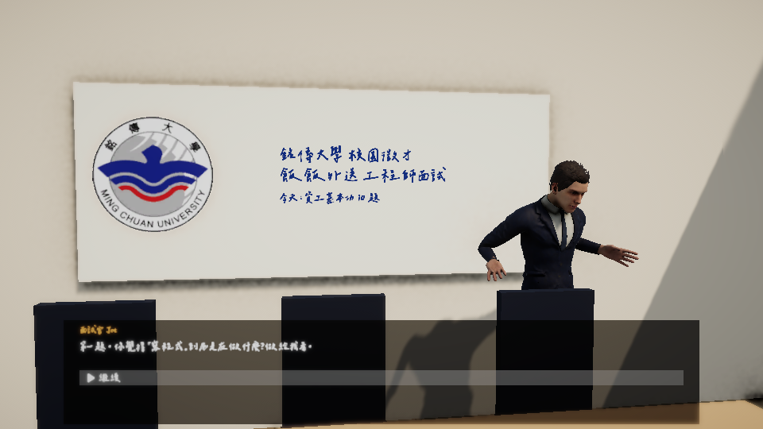
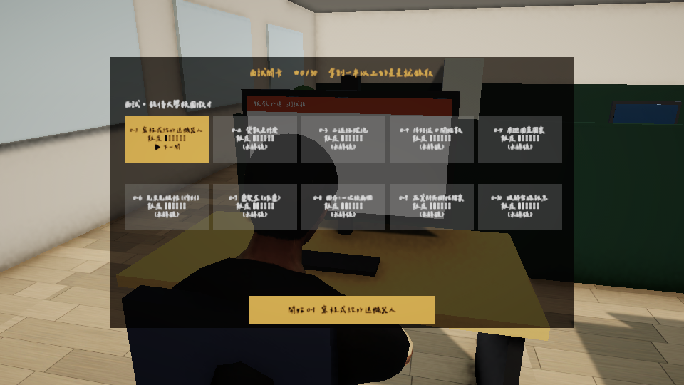
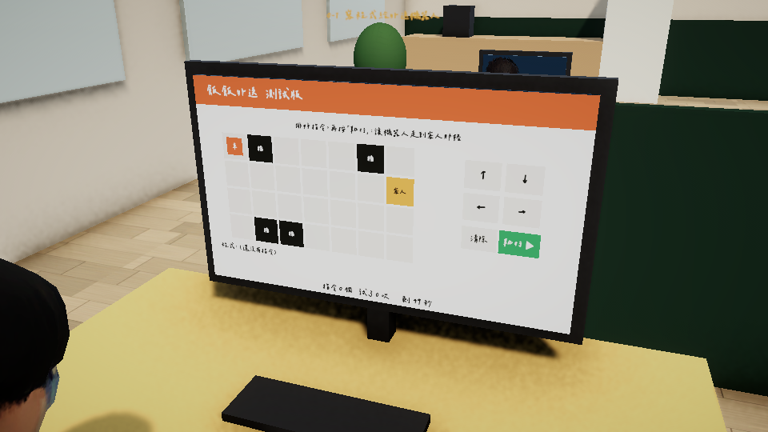
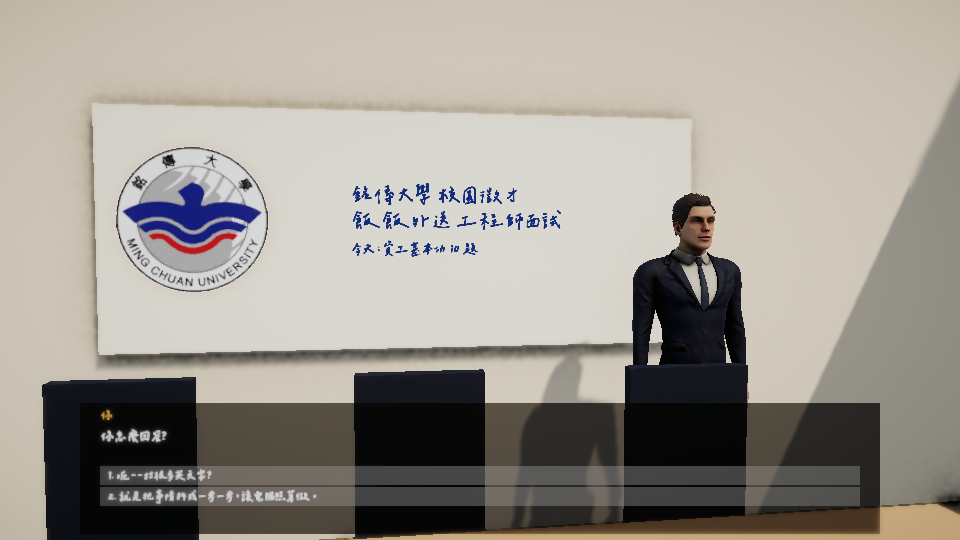

# 工程師的一天

讓**不是資工系的人**，用一個多小時體驗資工系畢業生的第一份工作：先面試，再上班三天。

《數位孿生與 VR 虛擬場景製作》（大三上）期末專案。Unity 6 製作，主角是作者本人的 3D 掃描模型。



## 怎麼玩

1. 下載 [Releases](../../releases) 裡的 `工程師的一天-Windows.zip`，解壓縮。
2. 打開 `工程師的一天.exe`，全程只要用滑鼠點。

一個關卡的流程：
- 有人來找你說話，你從打亂順序的選項裡選一個回答。
- 你坐在電腦前，在螢幕上玩一個小遊戲，拿 0～3 顆星。
- 結果卡會教一個資工小知識。

| 章節 | 關卡數 | 內容 |
|---|---|---|
| 面試・銘傳大學校園徵才 | 10 | 資工基本功：程式、變數、二進位、陣列、迴圈、佇列、堆疊、排序、樹狀結構、加密。星星超過一半才錄取 |
| 週一・菜鳥報到 | 5 | 抓蟲、找不同、訊息分類、術語翻譯、按下上線鍵 |
| 週三・上線連環爆 | 5 | 分流、釣魚信、搶救備份、強密碼、照順序重啟伺服器 |
| 週五・裁員名單 | 5 | 排工作、接通網路、找出壞掉的版本、擋下假流量、上線前檢查 |

- 25 關各玩一種不同的小遊戲，難度一關比一關高。
- 每天下班會跟主管談話，你的選擇會影響「主管信任」和「技術債」。
- 遊戲共有 6 種結局：「面試沒過」、轉正加薪、撐過第一週、準時下班的人、通過試用期但⋯⋯，還有「試用期沒過」。

| 關卡地圖 | 螢幕上的小遊戲 | 對話選擇 |
|---|---|---|
|  |  |  |

## 用到的課程技術

| 週次 | 技術 | 在遊戲裡 |
|---|---|---|
| 第 6～7 週 | Blender 模型清理、AI 綁骨 | 主角：照片 → TRELLIS 3D → Blender 自動綁骨 → `Player.fbx` |
| 第 9 週 | Mecanim 動作庫 | Mixamo 動作套到主角和同事身上（打字、說話、點頭、搖頭、生氣） |
| JohnLemon | NavMesh 巡邏、Observer | 舊版辦公室場景的主管巡邏 |
| 第 10 週 | 使用者介面 | 字幕列和選項（Screen Space Overlay ＋ Canvas Scaler）、電腦螢幕上的小遊戲（World Space Canvas）、頭上會面向鏡頭的名牌（Billboard） |
| 其他 | Cinemachine | 固定機位切換、臉部特寫景深 |

## 開發

- Unity **6000.3.25f1**、URP、Cinemachine 3、Input System。
- 場景由程式產生，不要手動改 `Round1.unity`。下面這些指令都要**先關掉 Unity** 再跑。

```bash
sh build-scene.sh            # 重建場景（RoundBuilder.Build）
sh run-tests.sh RoundTest    # 自動試玩 25 關＋檢查關卡資料，結果在 test-results.xml
```

- 打包 Windows 版：Unity 選單 `Course/6. 打包 Windows 執行檔`，輸出到 `Build/`。
- 關卡內容都在 `VirtualGame/Assets/Course/Resources/levels.json`，包括對白、選項、小知識和難度。
- 小遊戲都繼承 `MonitorGame`，放在 `VirtualGame/Assets/Course/Scripts/Round/`。

## 素材與授權

| 素材 | 來源 | 授權 |
|---|---|---|
| 字體：辰宇落雁體 | [Chenyu-otf/chenyuluoyan_thin](https://github.com/Chenyu-otf/chenyuluoyan_thin) | OFL 1.1，授權檔見 `VirtualGame/Assets/Course/Fonts-LICENSE-ChenYuluoyan.txt` |
| 角色動作、主管和同事模型 | Mixamo | |
| 銘傳大學校徽 | 作者提供 | 僅用於課堂作業 |
